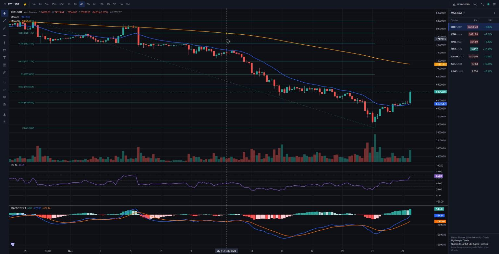

# Chart-Tool

Ein eigenes Chart-Tool im Browser, das sich wie TradingView bedienen lässt – ohne Abo, ohne Limits, mit eigenen Indikatoren.
Läuft komplett statisch (HTML, CSS, JavaScript) auf GitHub Pages, als Teil meines Portfolios neben dem
[Makro-Terminal](https://github.com/pacino112/makro-terminal).

**Live:** https://pacino112.github.io/chart-tool/



## Funktionen

- **Chart:** Kerzen und Volumen live von Binance, 15 Zeitrahmen (1m bis 1M), unbegrenzte Historie beim
  Zurückscrollen, Fadenkreuz mit OHLC, Log-Skala, Symbolsuche über alle Binance-Spot-Paare
- **Aktien, ETFs, Rohstoffe:** über Binance Futures, z. B. `NVDAUSDT.P`, `MSTRUSDT.P`, `TSLAUSDT.P`,
  `QQQUSDT.P` (Nasdaq-100), `SPYUSDT.P` (S&P 500), `IWMUSDT.P` (Russell 2000), `XAUUSDT.P` (Gold), dazu rund 250 weitere
- **Zeichnen:** Trendlinie, Strahl, horizontale/vertikale Linie, Rechteck, Text, Fibonacci mit eigenen Levels, Volumenprofil über frei gewählte Kerzen
  (inkl. 0.886), Messwerkzeug. Verschieben, Farbe, Rückgängig/Wiederholen. Pro Symbol gespeichert, auf allen Zeitrahmen sichtbar
- **Indikatoren:** SMA, EMA, Bollinger, VWAP, Volumen-MA, RSI, MACD, Stochastic RSI, ATR, Volumenprofil
  (POC, Value Area, Kauf-/Verkaufsvolumen), beliebig viele mit eigenen Parametern und Farben
- **Watchlist:** Live-Kurs und 24h-Veränderung, hinzufügen per Stern oder „+“, sortieren per Ziehen
- **Speichern:** alles im Browser, dazu Sicherung als JSON exportieren/importieren
- **Handy:** bedienbar per Touch, Watchlist als Schublade
- **Ohne Abo, ohne Limits:** keine Anmeldung, kein Server, keine Begrenzung bei Zeichnungen, Indikatoren oder Watchlist

## Technik

- **Kein Server, kein Build-Prozess** – `index.html` öffnen und loslegen (auch direkt per Doppelklick).
- **Chart-Darstellung:** [Lightweight Charts](https://github.com/tradingview/lightweight-charts) v5.0.8 (Apache-2.0), eingebunden über unpkg.
  Das TradingView-Logo unten links ist die von der Lizenz verlangte Namensnennung.
- **Daten:** öffentliche Binance-API ohne Schlüssel
  - Kerzen über REST: `/api/v3/klines` (1000 Kerzen pro Abruf, ältere werden beim Scrollen nach links unbegrenzt nachgeladen)
  - Live-Kerze über WebSocket: `<symbol>@kline_<interval>`
  - Watchlist: Startwerte über `/api/v3/ticker/24hr`, live über eine WebSocket-Verbindung mit `<symbol>@miniTicker`
    (Symbole werden per `SUBSCRIBE`/`UNSUBSCRIBE` an- und abgemeldet, ohne neu zu verbinden)
  - Symbolliste: `/api/v3/exchangeInfo` (24 h im Browser zwischengespeichert)
  - Ausweich-Server, falls `api.binance.com` nicht erreichbar oder gesperrt ist: `data-api.binance.vision` / `data-stream.binance.vision`
  - **Futures** (Aktien, ETFs, Rohstoffe, Krypto-Perpetuals): `fapi.binance.com/fapi/v1/…` und `wss://fstream.binance.com/ws`.
    Im Tool tragen Futures-Symbole die Endung `.P` (wie bei TradingView). An Binance geht das Symbol ohne Endung.
    Aktien heißen bei Binance „TradFi-Perpetuals“ (`underlyingType` EQUITY/COMMODITY …). Wichtig:
    - Es sind Kontrakt-Preise in USDT, gehandelt rund um die Uhr. Sie folgen dem Basiswert eng, können aber
      außerhalb der Börsenzeiten abweichen
    - Die Historie beginnt erst mit der Listung bei Binance (z. B. NVDA 26.03.2026, QQQ/SPY 06.04.2026)
    - `SPXUSDT.P` ist ein Meme-Coin, **nicht** der S&P 500. Dafür `SPYUSDT.P` nehmen
- **Speichern:** `localStorage` (Präfix `ct.`). Zeichnungen pro Symbol unter `ct.drawings.<SYMBOL>`.
  Export/Import als JSON-Sicherung über die Werkzeugleiste. Exportiert wird alles, was das Tool speichert,
  außer der Symbolliste (die wird ohnehin neu geladen).

## Aufbau

```
index.html        Layout: Topbar, Werkzeugleiste links, Chart, Watchlist rechts, Suchfenster
css/style.css     Dunkles Design, Grid-Layout, schmale Bildschirme
js/storage.js     CT.store – localStorage-Hilfen (get/set/remove/keys) und JSON-Sicherung (exportAll/importAll)
js/binance.js     CT.binance – Spot + Futures: REST (klines, exchangeInfo, 24h-Ticker) und WebSockets mit Auto-Reconnect
js/chart.js       CT.chart – Kerzen, Volumen, Legende, Log-Skala, Live-Updates, Historie nachladen
js/symbols.js     CT.symbols – Symbolliste (Spot + Futures) laden, zwischenspeichern, durchsuchen, Filter
js/drawings.js    CT.drawings – Zeichenwerkzeuge: Canvas-Ebene, Treffer, Ziehen, Eigenschaften, Verlauf, Export
js/ta.js          CT.ta – Rechenfunktionen wie Pine ta.* (sma, ema, rma, stdev, rsi, stoch, macd, atr, vwap …)
js/indicators.js  CT.indicators – Indikator-Definitionen (DEFS), Serien/Bereiche, Legenden, Einstellungsfenster
js/watchlist.js   CT.watchlist – Watchlist: Live-Kurse, 24h-Veränderung, hinzufügen/entfernen/sortieren
js/app.js         Verdrahtung: Zeitrahmen, Symbolsuche, Watchlist/Seitenleiste, Tastenkürzel, URL-Hash, Status
docs/             Screenshot für die README
```

Alle Module hängen am globalen Objekt `window.CT` und werden als normale `<script>`-Dateien geladen
(keine ES-Module), damit das Tool auch ohne Webserver per `file://` läuft.

**Zeitstempel:** Die Chart-Zeit ist immer echte UTC-Zeit in Sekunden (`toChartTime(ms)` = `ms / 1000`).
Die Ortszeit entsteht nur bei der Anzeige über `timeFormatter` und `tickMarkFormatter`
(Tages-/Wochen-/Monatskerzen werden in UTC formatiert, damit das Datum stimmt).
Zeiten nie pro Kerze in Ortszeit verschieben: Bei der Zeitumstellung entstehen sonst doppelte
Zeitstempel, und Lightweight Charts zeichnet gar nichts mehr. Zeichnungen und Indikatoren speichern
echte UTC-Millisekunden (`openTime`) und rechnen mit `toChartTime` / `fromChartTime` um.

**Zeichnungen:** Eine eigene Canvas liegt über dem Chart (`pointer-events: none`). Maus und Touch werden auf
`.chart-wrap` in der Capture-Phase abgefangen, bevor Lightweight Charts sie bekommt. Während gezeichnet oder
gezogen wird, ist Verschieben/Zoomen des Charts gesperrt. Punkte werden als `{ t, p }` gespeichert
(UTC-ms, Preis). Für die Anzeige wird `t` über die Kerzen des aktuellen Zeitrahmens in einen gebrochenen
Kerzenindex umgerechnet. Außerhalb der Daten wird mit der Kerzenlänge weitergerechnet, so lässt sich auch in die
Zukunft zeichnen. Achtung: `timeScale().logicalToCoordinate()` kennt nur ganze Indizes, deshalb interpoliert
`xOf()` selbst. Die Ebene wird nur neu gezeichnet, wenn sich Ansicht, Daten oder Zeichnungen ändern.

**Indikatoren:** Jede Instanz `{ id, type, params, visible, colors }` liegt in `ct.indicators`. Bei strukturellen
Änderungen (hinzufügen, entfernen, ein/aus, Parameter) baut `rebuild()` alle Indikator-Serien und Unterbereiche
neu auf. Bei neuen Kerzen (Event `data`) wird alles neu berechnet und gesetzt. Bei Live-Ticks (Event `tick`)
wird neu berechnet, aber nur der letzte Punkt per `update()` geschrieben. Die Berechnungen arbeiten immer auf allen
geladenen Kerzen und folgen der Pine-Logik (EMA/RMA mit SMA-Start, Stdev der Grundgesamtheit). Die Werte
entsprechen damit TradingView, sobald genug Historie geladen ist.

## Bedienung

| Aktion | So geht's |
|---|---|
| Symbol wechseln | Auf das Symbol oben links klicken oder einfach lostippen (z. B. `ETH`), Enter |
| Aktien finden | In der Suche z. B. `NVDA` oder `QQQ` tippen, oder Filter „Aktien & ETFs“ / „Rohstoffe“ wählen |
| Volumenprofil | Indikatoren → „Volumenprofil“: Zeilen, Breite, Value Area %, sichtbarer Bereich oder alle Kerzen, links/rechts |
| Zeitrahmen | Leiste oben: 1m, 3m, 5m, 15m, 30m, 1h, 2h, 4h, 6h, 8h, 12h, 1D, 3D, 1W, 1M |
| Zoom | Mausrad / Pinch, Ziehen auf Preis- oder Zeitachse |
| Log-Skala | Knopf `Log` oder `Alt+L` |
| Ansicht zurücksetzen | Knopf rechts neben `Log` oder `Alt+R` |
| Link teilen | Die URL enthält Symbol und Zeitrahmen, z. B. `index.html#SOLUSDT/4h` |
| Zeichnen | Werkzeug links wählen, dann ziehen **oder** zweimal klicken (Start- und Endpunkt) |
| Trendlinie / Strahl | `Alt+T` / `Alt+X` |
| Horizontale / vertikale Linie | `Alt+H` / `Alt+V` (ein Klick) |
| Rechteck / Text | `Alt+B` / `Alt+K` |
| Fibonacci | `Alt+F`, Levels über „Levels“ in der Eigenschaftsleiste ändern (Standard inkl. 0.886) |
| Messen | `Alt+M`: Preis- und Prozentdifferenz, Anzahl Kerzen, Dauer. Wird nicht gespeichert |
| Volumenprofil (Bereich) | `Alt+P`: über die gewünschten Kerzen ziehen. POC, Value Area, Kauf/Verkauf. „Profil“ im Menü: Zeilen, Value Area %, Breite % |
| Bearbeiten | Zeichnung anklicken: Körper ziehen = verschieben, Punkt ziehen = Punkt ändern; Leiste oben: Farbe, Stärke, gestrichelt |
| Löschen | `Entf`/`Backspace` oder Papierkorb in der Leiste; alle Zeichnungen des Symbols: Papierkorb links |
| Rückgängig / Wiederholen | `Strg+Z` / `Strg+Y` (oder `Strg+Umschalt+Z`) |
| Abbrechen | `Esc` |
| Sicherung | Pfeil nach unten = Export als JSON, Pfeil nach oben = Import |
| Indikatoren | Knopf „Indikatoren“ oben oder `/`: hinzufügen, ein/aus, Parameter und Farben ändern |
| Indikator in der Legende | Maus auf die Zeile: Auge = aus/ein, Zahnrad = Einstellungen, ✕ = entfernen |
| Bereiche | Trennlinie zwischen Kurs-Chart und Indikator-Bereichen mit der Maus ziehen, um die Höhe zu ändern |
| Watchlist | Zeile anklicken = Symbol öffnen, ✕ = entfernen, Zeile ziehen = Reihenfolge ändern |
| Zur Watchlist | Stern neben dem Symbol oben, Stern in der Symbolsuche oder „+“ in der Watchlist |
| Watchlist durchblättern | Pfeil hoch / runter |
| Watchlist ein-/ausblenden | Knopf ganz rechts oben oder `Alt+W` (am Handy öffnet er die Schublade) |

Der Punkt oben rechts zeigt die Live-Verbindung des Charts: grün = live, gelb = verbindet, rot = getrennt.

**Am Handy:** Zeichnen mit dem Finger (Werkzeug wählen, dann ziehen oder zweimal tippen). Die Eigenschaftsleiste
einer ausgewählten Zeichnung erscheint unten. Die Knöpfe in der Indikator-Legende und das ✕ in der Watchlist sind
auf Touch-Geräten immer sichtbar.

## Fortschritt

Das Projekt wird in 5 Sitzungen gebaut, pro Sitzung ein Schritt. Schritt 5 wurde vorgezogen, weil die
Pine-Dateien für Schritt 4 noch fehlen. **Offen ist damit nur noch Schritt 4.**

- [x] **Schritt 1 – Grundgerüst, Chart, Binance-Daten, Zeitrahmen, Symbolsuche** *(fertig)*
  - Layout mit Topbar, Werkzeugleiste links (Platzhalter), Watchlist rechts (Platzhalter)
  - Kerzen + Volumen, Live-Update per WebSocket mit automatischem Neuverbinden und Lückenschluss
  - Alle 15 Zeitrahmen, unbegrenztes Nachladen älterer Historie beim Scrollen nach links
  - Fadenkreuz mit OHLC, Veränderung und Volumen in der Legende
  - Logarithmische Skala, Zoom, Ansicht zurücksetzen
  - Symbolsuche über alle Binance-Spot-Paare mit Quote-Filter, „Zuletzt geöffnet“ und „Beliebt“
  - Preisnachkommastellen passend zur Tick-Größe des Paars
  - Symbol, Zeitrahmen und Log-Einstellung werden gespeichert und stehen in der URL
- [x] **Schritt 2 – Zeichenwerkzeuge mit Speichern und Export** *(fertig)*
  - Trendlinie, Strahl, horizontale/vertikale Linie, Rechteck, Text (mehrzeilig), Fibonacci, Messwerkzeug
  - Fibonacci mit eigenen Levels (Standard 0 / 0.236 / 0.382 / 0.5 / 0.618 / 0.786 / 0.886 / 1), zuletzt gewählte Levels werden Standard
  - Auswählen, Verschieben (ganze Zeichnung oder einzelne Punkte), Farbe (8 Vorgaben + frei wählbar), Linienstärke, gestrichelt
  - Zuletzt gewählte Farbe pro Werkzeug wird zum Standard für neue Zeichnungen
  - Löschen einzeln oder alle, Rückgängig/Wiederholen (500 Schritte), Ausblenden
  - Unbegrenzt viele Zeichnungen, gespeichert pro Symbol, sichtbar auf allen Zeitrahmen, Zeichnen in die Zukunft möglich
  - JSON-Sicherung: Export und Import (ungültige Einträge werden beim Laden aussortiert)
  - Getestet: Zeichnen per Ziehen und per Klick-Klick, Verschieben ohne Chart-Mitbewegung, Farbe, Undo/Redo,
    Entf, Zeitrahmenwechsel 1h → 4h → 1D, Symbolwechsel, Neuladen, Import
  - Touch in Schritt 5 in der Handy-Emulation geprüft (siehe dort)
- [x] **Schritt 3 – Standard-Indikatoren** *(fertig)*
  - Im Chart: SMA, EMA, Bollinger-Bänder, VWAP (Neustart je Tag/Woche/Monat, UTC). Auf der Volumen-Skala: Volumen-MA
  - Eigene Bereiche darunter: RSI (fest 0–100, Linien 70/50/30), MACD (Histogramm in TradingView-Farben),
    Stochastic RSI (K/D, Linien 80/50/20), ATR
  - Beliebig viele Instanzen (z. B. EMA 20 + EMA 50 + EMA 200), jede ein-/ausschaltbar, mit eigenen Parametern,
    Quelle (close/open/high/low/hl2/hlc3/ohlc4) und Farben
  - Legende pro Indikator mit Werten am Fadenkreuz, Knöpfe für Aus/Ein, Einstellungen, Entfernen
  - Live-Update mit jeder Kerze. Einstellungen werden gespeichert und sind Teil der JSON-Sicherung
  - Zeichnungen bleiben auf den Kurs-Bereich beschränkt, wenn Unterbereiche offen sind
  - Getestet: alle 9 Indikatoren gleichzeitig. SMA, RSI und ATR nachgerechnet (identisch, auch im Live-Betrieb).
    MACD-Histogramm = MACD − Signal. Parameter ändern, Ein/Aus, Neuladen, Zeitrahmen- und Symbolwechsel
- [ ] **Schritt 4 – Eigene Indikatoren aus den Pine-Dateien** *(als Nächstes, wartet auf die Pine-Dateien)*
  - Momentum-Sigma, Pullback-Oszillator mit Strong-Buy-Zone, Deviation-Bänder, Weekly MA50
  - So geht's: in `js/indicators.js` je einen Eintrag in `DEFS` ergänzen (`params`, `plots`, `calc`, `place`).
    Rechenbausteine wie Pine `ta.*` liegen in `js/ta.js` (sma, ema, rma, stdev, rsi, stoch, atr, highest, lowest …)
  - Weekly MA50 braucht Wochenkerzen unabhängig vom Zeitrahmen → eigene Abfrage `CT.binance.klines(symbol, '1w')`
  - Flächen zwischen Linien (z. B. Strong-Buy-Zone) kann Lightweight Charts nicht direkt → Histogramm/Baseline-Serie oder eigene Canvas
- [x] **Schritt 5 – Watchlist, Design, Handy-Ansicht, README** *(fertig, vorgezogen)*
  - Watchlist rechts: Live-Kurs mit kurzem Aufblinken bei Änderung, 24h-Veränderung in %, beliebig viele Symbole
  - Hinzufügen über Stern (neben dem Symbol und in der Suche) oder „+“ (Suche im Hinzufügen-Modus),
    entfernen per ✕, Reihenfolge per Ziehen, Pfeil hoch/runter blättert durch die Liste
  - Seitenleiste am Desktop ausblendbar (gespeichert), am Handy als Schublade von rechts
  - Handy: Browser-Gesten auf dem Chart aus (`touch-action: none`), Safe-Areas für Notch, größere Zeilen,
    Eigenschaftsleiste unten, Hover-Knöpfe auf Touch-Geräten immer sichtbar
  - Favicon, Fußzeile mit Quellen und Links, Fibonacci-Beschriftung rutscht nach innen, wenn links kein Platz ist
  - README mit Funktionsübersicht und Screenshot
  - Getestet: Watchlist (Live-Updates, Klick, Pfeiltasten, Stern, „+“, Speichern, Ein-/Ausblenden) in Chrome;
    Handy-Ansicht 375 × 812 mit Touch-Emulation: Schublade, Symbol öffnen, Trendlinie per Touch ziehen
  - Nicht getestet: echtes iPhone/Android-Gerät, Sortieren per Ziehen (HTML-Drag-and-Drop lässt sich automatisiert
    nicht zuverlässig auslösen) → einmal selbst ausprobieren
- [x] **Zusatz – Aktien über Binance Futures und Volumenprofil** *(fertig)*
  - Rund 250 Aktien, ETFs und Rohstoffe als Futures (`.P`) in Suche, Chart, Watchlist, Zeichnungen und Indikatoren.
    Neue Suchfilter: Aktien & ETFs, Rohstoffe, Krypto Spot, Futures
  - Volumenprofil (sichtbarer Bereich oder alle Kerzen): Kauf-/Verkaufsvolumen je Preiszeile, POC,
    Value Area (VAH/VAL), Werte in der Legende. Das Volumen jeder Kerze wird anteilig über ihre Spanne von Tief
    bis Hoch verteilt, denn Binance liefert keine Umsätze pro Preis
  - Behoben: Die Legendenpositionierung startete bei jedem Neuaufbau eine weitere Endlosschleife
  - Getestet: NVDA 1h/1D live (Historie ab Listung, Zurückscrollen stoppt sauber), Suche/Filter, NVDA/QQQ/Gold in
    der Watchlist live, Zeichnung auf NVDA getrennt gespeichert und in der Sicherung, Volumenprofil auf NVDA und BTC
    (POC liegt innerhalb der Value Area, diese innerhalb der Kursspanne)
- [x] **Zusatz – Volumenprofil als Zeichnung, Menü-Fehler behoben** *(fertig)*
  - Neues Werkzeug „Volumenprofil (Bereich)“ wie „Fixed Range Volume Profile“ bei TradingView: über beliebige Kerzen
    ziehen. Das Profil steht am linken Rand des Bereichs, dazu POC mit Preis, VAH/VAL und Rahmen.
    Lässt sich verschieben (rechnet für die neuen Kerzen neu) und wird pro Symbol gespeichert. Auf jedem
    Zeitrahmen wird es aus den dortigen Kerzen neu berechnet
  - Behoben: Klicks auf das kleine Menü einer Zeichnung (Farbe, Stärke, Löschen …) wurden von der Zeichen-Ebene
    abgefangen und gingen verloren. Die Ebene reagiert jetzt nur noch auf Klicks direkt auf dem Chart
  - Getestet mit echten Mausklicks: Trendlinie → Farbe rot, Löschen über das Menü, Volumenprofil ziehen/verschieben,
    1h → 4h, Stärke und „Profil“-Einstellungen. Gegenprobe: Summe des Profils = Summe des Kerzenvolumens,
    Value Area ≥ eingestellter Anteil

## Lokal starten

`index.html` im Browser öffnen. Optional mit lokalem Server, z. B. `python -m http.server` im Projektordner.

## GitHub Pages

Veröffentlicht aus Branch `main`, Ordner `/ (root)` (Repository → Settings → Pages).
Erreichbar unter https://pacino112.github.io/chart-tool/.
